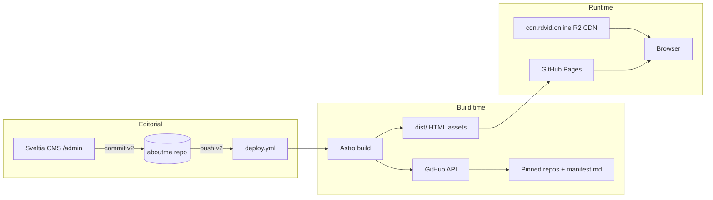

# rdvid-site (aboutme)

Personal portfolio, bilingual static site, and Markdown blog — static-first, content-driven, deployed on GitHub Pages with a custom domain.

[](https://github.com/rdvid/aboutme/actions/workflows/deploy.yml)

**Live site:** [me.rdvid.online](https://me.rdvid.online) · **CMS:** [me.rdvid.online/admin/](https://me.rdvid.online/admin/) · **Repository:** [github.com/rdvid/aboutme](https://github.com/rdvid/aboutme)

| | |
|---|---|
| 🇺🇸 **English** | [Overview](#overview) · [Features](#features-and-usability) · [Stack](#technical-stack) · [Architecture](#architecture) · [Getting started](#getting-started) · [Deployment](#deployment-and-operations) · [Docs](#documentation) |
| 🇧🇷 **Português** | [Visão geral](#visão-geral) · [Funcionalidades](#funcionalidades-e-usabilidade) · [Stack](#stack-tecnológica) · [Arquitetura](#arquitetura) · [Primeiros passos](#primeiros-passos) · [Implantação](#implantação-e-operações) · [Documentação](#documentação) |

<div align="center">


</div>

---

## Overview

### Table of contents

- [Overview](#overview)
- [Features and usability](#features-and-usability)
- [Technical stack](#technical-stack)
- [Architecture](#architecture)
- [Current implementation notes](#current-implementation-notes)
- [Project structure](#project-structure)
- [Getting started](#getting-started)
- [Usage](#usage)
- [Development](#development)
- [Deployment and operations](#deployment-and-operations)
- [Security](#security)
- [Troubleshooting](#troubleshooting)
- [Roadmap](#roadmap)
- [Contributing](#contributing)
- [License and contact](#license-and-contact)
- [Documentation](#documentation)
- [Visão geral (Português)](#visão-geral)

This repository **is** the portfolio surface: a personal website and Markdown blog that demonstrates a static-site workflow — Astro SSG, bilingual routes, build-time GitHub integration for projects, and editorial tooling via Sveltia CMS.

**Intended audience:** visitors reading the site, and developers cloning the repo to run or extend it.

**Out of scope:** server-side rendering, user accounts on the site itself (GitHub OAuth/token is only for CMS editors), and hosting blog media in Git (covers use Cloudflare R2).

### Features and usability

| Area | Status | How it works |
|------|--------|----------------|
| Home, About, Projects, Blog | Implemented | Locale-prefixed routes `/en/...` and `/br/...`; `/` redirects to default locale (`en`). |
| Bilingual UI | Implemented | Copy in `src/i18n/ui.ts`; language toggle preserves path when possible. |
| Blog posts | Implemented | Markdown under `src/content/blog/{en,br}/`; Zod schema in `src/content.config.ts`. |
| Draft posts | Implemented | `draft: true` in frontmatter excludes posts from public listings. |
| Sveltia CMS | Implemented | `/admin/` loads Sveltia; commits content to branch **`v2`** via GitHub backend. |
| Blog cover images (R2) | Implemented | Uploads to Cloudflare R2; see [docs/sveltia-cms-media.md](docs/sveltia-cms-media.md). |
| Dynamic projects grid | Implemented | Build fetches GitHub **pinned** repos (max 6) + each repo’s `public/manifest.md` and `public/cover.png`. |
| Dark / light theme | Implemented | DaisyUI themes (`lofi` / `business`) + `localStorage`. |
| RSS / sitemap | Planned | Listed in [Roadmap](#roadmap). |

**Primary journeys**

1. **Visitor** — Browse about, projects, and blog in English or Portuguese; open project detail modal; download locale-specific resume PDF from `public/`.
2. **Author (CMS)** — Sign in at `/admin/` with a GitHub PAT → edit posts → save (Git commit on `v2`) → deploy refreshes the site.
3. **Author (Git)** — Edit Markdown in `src/content/blog/` → push/merge to **`v2`** (or open a PR targeting `v2`).
4. **Maintainer (projects)** — Update pins or `public/manifest.md` / `public/cover.png` in pinned repos → site picks up changes on the next **aboutme** deploy (see [Deployment](#deployment-and-operations)).

### Technical stack

| Layer | Technology | Role |
|-------|------------|------|
| Site generator | [Astro](https://astro.build/) 7 | SSG, file-based routing, content collections |
| Language | TypeScript | Types for i18n, projects, content schema |
| Styling | Tailwind CSS 4 + DaisyUI 5 | Utilities and themes |
| Content | Markdown (+ optional MDX path in roadmap) | Blog body and frontmatter |
| CMS | [Sveltia CMS](https://sveltiacms.app/) | Git-backed editorial UI |
| Media | Cloudflare R2 | Blog hero images (S3-compatible API) |
| Projects data | GitHub GraphQL + raw files | Pinned repos and per-repo manifests |
| Markdown (projects) | `marked`, `gray-matter` | Manifest parsing for project modals |
| Hosting | GitHub Pages | Static `dist/`; custom domain via `CNAME` |
| CI/CD | GitHub Actions | Build and deploy on push to `v2`, schedule, manual run |
| Local optional | Docker / Compose | Dev server in container (port 4321) |

Runtime: **Node.js ≥ 22.12.0** (`package.json` `engines`); CI pins **22.12.0**; `.nvmrc` lists **24.15.0** for local nvm users.

### Architecture

**Style:** Static site generation only — no Astro adapter, no SSR. All public HTML is produced at `npm run build`.



**Projects data flow**

1. `loadPortfolioProjects()` ([`src/lib/projects.ts`](src/lib/projects.ts)) calls GitHub for pinned repositories.
2. For each pin, it fetches `public/manifest.md` and builds cover URL from `public/cover.png` on the default branch.
3. On success in production, results are written to [`src/data/projects.snapshot.json`](src/data/projects.snapshot.json) as a fallback if a later build cannot reach GitHub.

**Blog media:** Frontmatter may store absolute CDN URLs; [`src/lib/blog-media.ts`](src/lib/blog-media.ts) resolves paths for display.

### Current implementation notes

No formal ADR directory exists in this repository. Observable choices:

| Topic | Choice | Trade-off |
|-------|--------|-----------|
| Deploy branch | `v2` (not `main`) | CMS and Actions target the same branch; default branch settings affect scheduled workflows. |
| Projects refresh | Build-time fetch | Simple and fast static pages; requires redeploy to see pin/manifest changes. |
| Snapshot file | Committed JSON cache | Builds survive GitHub rate limits or API errors; successful prod builds refresh it. |
| Locales | `en` + `br` only | Reduced from an earlier multi-locale experiment; post slugs should match across folders for the lang toggle. |

### Project structure

```text
aboutme/
├── .github/workflows/deploy.yml   # GitHub Pages build + deploy
├── public/
│   ├── admin/                     # Sveltia config.yml + admin entry (via src/pages/admin)
│   └── images/                    # Repo-local assets (legacy blog images, uploads)
├── src/
│   ├── content/blog/en|br/        # Markdown posts
│   ├── content.config.ts          # Blog collection schema
│   ├── components/                # Header, Footer, ProjectCard, blog UI
│   ├── data/                      # site.ts, projects.snapshot.json
│   ├── i18n/                      # UI strings and path helpers
│   ├── layouts/                   # BaseLayout, BlogPost
│   ├── lib/                       # GitHub pins, manifests, blog helpers
│   ├── pages/                     # Routes (incl. [lang]/, admin, redirects)
│   └── views/                     # Page-level compositions
├── templates/public/              # manifest.md template for pinned repos
├── docs/                          # Deep dives (R2, pinned repos, examples)
├── Dockerfile / docker-compose.yml  # Optional containerized dev
├── CNAME                          # me.rdvid.online
└── astro.config.mjs               # site URL, Tailwind Vite plugin
```

Generated or local-only paths (not documented in tree): `node_modules/`, `dist/`, `.env`.

### Getting started

**Prerequisites**

- Node.js **≥ 22.12.0** (or use `nvm use` with `.nvmrc`)
- npm (lockfile: `package-lock.json`)

**Steps**

```bash
git clone https://github.com/rdvid/aboutme.git
cd aboutme
npm ci
cp .env.example .env   # optional but recommended for projects + API limits
# Edit .env: set GH_PAT to a GitHub PAT with read access to public repos
npm run dev
```

Open [http://localhost:4321](http://localhost:4321). Dev server port and host are set in [`astro.config.mjs`](astro.config.mjs) (default port **4321**).

**Verify build**

```bash
npm run build
npm run preview
```

**Optional: Docker dev**

```bash
docker compose up --build
```

Requires an external Docker network `homelab` as defined in [`docker-compose.yml`](docker-compose.yml); adjust or create the network for your environment.

**Environment variables**

| Variable | Required | Purpose |
|----------|----------|---------|
| `GH_PAT` | Recommended locally | GitHub PAT for pinned-repo and manifest fetches; avoids unauthenticated rate limits. |
| `GITHUB_TOKEN` | CI only (automatic) | Provided by GitHub Actions during deploy build. |

Do not commit `.env` or R2 secret keys. R2 credentials for CMS are documented in [docs/sveltia-cms-media.md](docs/sveltia-cms-media.md).

### Usage

**Add or edit a blog post (Git)**

1. Create or edit files under `src/content/blog/en/` and/or `src/content/blog/br/`.
2. Use the same filename (slug) in both locales when publishing bilingual posts.
3. Merge or push to **`v2`** to trigger deployment.

**Edit via CMS**

1. Open [me.rdvid.online/admin/](https://me.rdvid.online/admin/).
2. Authenticate with a GitHub personal access token (fine-grained: Contents read/write on this repo).
3. Publish; Sveltia commits to **`v2`**.

**Configure a pinned project repo**

Copy [`templates/public/manifest.template.md`](templates/public/manifest.template.md) to `public/manifest.md` in the pinned repository and add `public/cover.png`. Full guide: [docs/repositorios-fixados-projetos.md](docs/repositorios-fixados-projetos.md) (Portuguese).

### Development

| Command | Description |
|---------|-------------|
| `npm run dev` / `npm start` | Astro dev server |
| `npm run build` | Production static build → `dist/` |
| `npm run preview` | Serve built output locally |

Conventions: TypeScript in `src/`, Astro components for UI, content schema changes in `src/content.config.ts`. In dev, successful project fetches do **not** rewrite `projects.snapshot.json` (avoids Vite reload loops).

### Deployment and operations

Workflow: [`.github/workflows/deploy.yml`](.github/workflows/deploy.yml)

| Trigger | Behavior |
|---------|----------|
| Push to **`v2`** | `npm ci` → `npm run build` → GitHub Pages deploy |
| `workflow_dispatch` | Manual run from Actions tab |
| Schedule | `0 */2 * * *` — approximately every **2 hours** (GitHub may delay scheduled runs) |

**Important:** Changes in pinned project repositories do **not** update the live site until **aboutme** completes a new build. For immediate refresh, run **Deploy to GitHub Pages** manually.

Scheduled workflows run from the repository **default branch**; ensure `deploy.yml` on that branch matches what you expect.

Production URL is configured in [`astro.config.mjs`](astro.config.mjs) as `https://me.rdvid.online` with `base: '/'` and [`CNAME`](CNAME).

### Security

- **Secrets:** Keep `GH_PAT`, R2 secret keys, and CMS credentials out of Git. `public/admin/config.yml` may contain non-secret R2 identifiers; treat the repo as public when hardcoding IDs.
- **CMS access:** GitHub token–based sign-in to Sveltia; no site-wide login for visitors.
- **Static attack surface:** No server-side request handlers in production; dependency updates via npm and GitHub Dependabot (if enabled on the repo).

No `SECURITY.md` or license file is present in the repository at this time.

### Troubleshooting

| Symptom | Likely cause | What to try |
|---------|----------------|-------------|
| Empty or stale projects locally | API rate limit or missing `GH_PAT` | Set `GH_PAT` in `.env`; see `.env.example`. |
| Empty projects on live site | Last build failed API fetch | Check Actions logs; fix token/limits; redeploy. Snapshot may serve old data. |
| Pinned repo changes not visible | Static build not re-run | Push to `v2`, wait for cron, or run workflow manually. |
| CMS / R2 upload issues | CORS or Sveltia config | [docs/sveltia-cms-media.md](docs/sveltia-cms-media.md) troubleshooting section. |
| Scheduled deploy never runs | Workflow not on default branch | Merge `deploy.yml` to default branch or change default branch settings. |

### Roadmap

Tracked informally in this README (not a separate project board):

- [ ] RSS / sitemap for the blog
- [ ] Optional post preview checks on PRs
- [ ] Richer MDX when a post needs interactive components
- [ ] Tag pages / archive filters

### Contributing

1. Fork the repository and create a branch from **`v2`**.
2. For blog-only changes, limit diffs to `src/content/blog/` when possible.
3. Open a pull request targeting **`v2`** with a clear description.

For bugs and ideas, use [GitHub Issues](https://github.com/rdvid/aboutme/issues). No `CONTRIBUTING.md` file is defined yet.

### License and contact

**License:** Not documented in the repository (no `LICENSE` file found).

**Maintainer:** Rafael David — [GitHub](https://github.com/rdvid) · [LinkedIn](https://www.linkedin.com/in/rdvid/) · site [me.rdvid.online](https://me.rdvid.online)

### Documentation

| Document | Contents |
|----------|----------|
| [docs/sveltia-cms-media.md](docs/sveltia-cms-media.md) | R2, CORS, CMS, blog covers |
| [docs/repositorios-fixados-projetos.md](docs/repositorios-fixados-projetos.md) | Pinned repos, manifest, cover, deploy |
| [docs/description-example.md](docs/description-example.md) | Sample manifest |
| [templates/public/README.md](templates/public/README.md) | Template for pinned repositories |

---

## Visão geral

### Índice

- [Visão geral](#visão-geral)
- [Funcionalidades e usabilidade](#funcionalidades-e-usabilidade)
- [Stack tecnológica](#stack-tecnológica)
- [Arquitetura](#arquitetura)
- [Notas de implementação atual](#notas-de-implementação-atual)
- [Estrutura do projeto](#estrutura-do-projeto)
- [Primeiros passos](#primeiros-passos)
- [Utilização](#utilização)
- [Desenvolvimento](#desenvolvimento)
- [Implantação e operações](#implantação-e-operações)
- [Segurança](#segurança)
- [Solução de problemas](#solução-de-problemas)
- [Próximos passos](#próximos-passos)
- [Contribuição](#contribuição)
- [Licença e contato](#licença-e-contato)
- [Documentação](#documentação)

Este repositório **é** a vitrine do portfólio: site pessoal e blog em Markdown com abordagem **static-first**, rotas bilíngues, integração com GitHub no build para projetos fixados e edição via Sveltia CMS.

**Público-alvo:** visitantes do site e desenvolvedores que queiram clonar, rodar ou estender o projeto.

**Fora de escopo:** SSR, contas de usuário no site (autenticação GitHub é só para editores no CMS) e armazenar capas do blog no Git (mídia no Cloudflare R2).

### Funcionalidades e usabilidade

| Área | Status | Como funciona |
|------|--------|----------------|
| Home, Sobre, Projetos, Blog | Implementado | Rotas `/en/...` e `/br/...`; `/` redireciona para `en`. |
| UI bilíngue | Implementado | Textos em `src/i18n/ui.ts`; toggle de idioma mantém o caminho quando possível. |
| Posts | Implementado | Markdown em `src/content/blog/{en,br}/`; schema Zod em `src/content.config.ts`. |
| Rascunhos | Implementado | `draft: true` remove o post das listagens públicas. |
| Sveltia CMS | Implementado | `/admin/`; backend GitHub na branch **`v2`**. |
| Capas (R2) | Implementado | Upload no Cloudflare R2 — [docs/sveltia-cms-media.md](docs/sveltia-cms-media.md). |
| Grid de projetos | Implementado | Pins do GitHub (máx. 6) + `public/manifest.md` e `public/cover.png` em cada repo. |
| Tema claro/escuro | Implementado | DaisyUI + `localStorage`. |
| RSS / sitemap | Planejado | Ver [Próximos passos](#próximos-passos). |

**Jornadas principais**

1. **Visitante** — Navega about, projetos e blog; modal de detalhe do projeto; PDF de currículo por locale em `public/`.
2. **Autor (CMS)** — Login no `/admin/` com PAT do GitHub → editar → commit em **`v2`** → deploy.
3. **Autor (Git)** — Editar Markdown → push/merge em **`v2`** (ou PR para `v2`).
4. **Manutenção (projetos)** — Alterar pins ou manifest/capa nos repos fixados → site atualiza no próximo deploy do **aboutme** (ver [Implantação](#implantação-e-operações)).

### Stack tecnológica

Mesma stack da seção em inglês; papéis principais:

- **Astro 7** — SSG e content collections  
- **TypeScript** — Tipagem de i18n, projetos e conteúdo  
- **Tailwind 4 + DaisyUI 5** — Estilo e temas  
- **Sveltia CMS + Cloudflare R2** — Edição e capas do blog  
- **GitHub Actions + Pages** — Build e hospedagem estática  

Node: **≥ 22.12.0**; CI usa **22.12.0**; `.nvmrc` indica **24.15.0**.

### Arquitetura

Site **100% estático** no ar: `npm run build` gera `dist/`; não há adapter SSR.

O diagrama Mermaid na [seção Architecture (English)](#architecture) descreve build, GitHub Pages, CDN R2 e fluxo do CMS.

Fluxo de **projetos:** [`src/lib/projects.ts`](src/lib/projects.ts) consulta pins → lê `public/manifest.md` → cache em [`projects.snapshot.json`](src/data/projects.snapshot.json) em builds de produção bem-sucedidos.

### Notas de implementação atual

Não há pasta `docs/adr/`. Decisões observáveis:

| Tópico | Decisão | Trade-off |
|--------|---------|-----------|
| Branch de deploy | `v2` | CMS e Actions alinhados; cron depende da branch padrão do repo. |
| Projetos no build | Fetch no build | Páginas rápidas; exige redeploy para ver mudanças nos pins. |
| Snapshot JSON | Cache versionado | Resiliência a rate limit; pode ficar desatualizado se o build falhar. |
| Locales | `en` + `br` | Slugs iguais entre pastas para o toggle de idioma. |

### Estrutura do projeto

Árvore equivalente à seção [Project structure](#project-structure) (inglês). Documentação detalhada de mídia e projetos fixados em `docs/`.

### Primeiros passos

```bash
git clone https://github.com/rdvid/aboutme.git
cd aboutme
npm ci
cp .env.example .env
# Defina GH_PAT (leitura de repos públicos)
npm run dev
```

Build: `npm run build` · Preview: `npm run preview` · Docker opcional: `docker compose up --build` (rede `homelab` externa).

Variáveis: **`GH_PAT`** (local, recomendado); **`GITHUB_TOKEN`** (Actions, automático).

### Utilização

- **Blog via Git:** arquivos em `src/content/blog/en/` e `br/`; mesmo slug nos dois idiomas quando bilíngue; merge em **`v2`**.
- **Blog via CMS:** [me.rdvid.online/admin/](https://me.rdvid.online/admin/) com PAT do GitHub.
- **Repo fixado:** template em [`templates/public/`](templates/public/) e guia [docs/repositorios-fixados-projetos.md](docs/repositorios-fixados-projetos.md).

### Desenvolvimento

Comandos: `npm run dev`, `npm run build`, `npm run preview`. Em dev, o snapshot de projetos não é reescrito automaticamente (evita loop do Vite).

### Implantação e operações

Arquivo [`.github/workflows/deploy.yml`](.github/workflows/deploy.yml):

| Gatilho | Efeito |
|---------|--------|
| Push em **`v2`** | Build + deploy GitHub Pages |
| Manual (*Run workflow*) | Idem |
| Cron `0 */2 * * *` | Aproximadamente a cada **2 horas** |

Mudanças só nos repos fixados **não** atualizam o site até um novo build do aboutme. URL de produção: **me.rdvid.online** (`CNAME` + `astro.config.mjs`).

### Segurança

Não commitar `.env`, secret do R2 nem tokens. CMS protegido por PAT; visitantes não fazem login. Sem `SECURITY.md` no repositório.

### Solução de problemas

| Sintoma | Causa provável | Ação |
|---------|----------------|------|
| Projetos vazios/desatualizados local | Rate limit / sem `GH_PAT` | Configurar `.env` |
| Projetos stale no ar | Build falhou na API | Logs do Actions; redeploy |
| Pin/manifest não aparece | Sem redeploy | Push `v2`, cron ou workflow manual |
| R2 no CMS | CORS/config | [docs/sveltia-cms-media.md](docs/sveltia-cms-media.md) |

### Próximos passos

- [ ] RSS / sitemap  
- [ ] Preview de posts em PRs  
- [ ] MDX quando necessário  
- [ ] Páginas de tags / arquivo  

### Contribuição

Fork → branch a partir de **`v2`** → PR para **`v2`**. Issues no GitHub. Sem `CONTRIBUTING.md` dedicado.

### Licença e contato

**Licença:** não documentada (sem arquivo `LICENSE`).

**Maintainer:** Rafael David — [GitHub](https://github.com/rdvid) · [LinkedIn](https://www.linkedin.com/in/rdvid/) · [me.rdvid.online](https://me.rdvid.online)

### Documentação

| Documento | Conteúdo |
|-----------|----------|
| [docs/sveltia-cms-media.md](docs/sveltia-cms-media.md) | R2, CORS, CMS, capas do blog |
| [docs/repositorios-fixados-projetos.md](docs/repositorios-fixados-projetos.md) | Pins, manifest, capa, deploy |
| [docs/description-example.md](docs/description-example.md) | Exemplo de manifest |
| [templates/public/README.md](templates/public/README.md) | Template para repos fixados |

*(English: [Documentation](#documentation).)*
